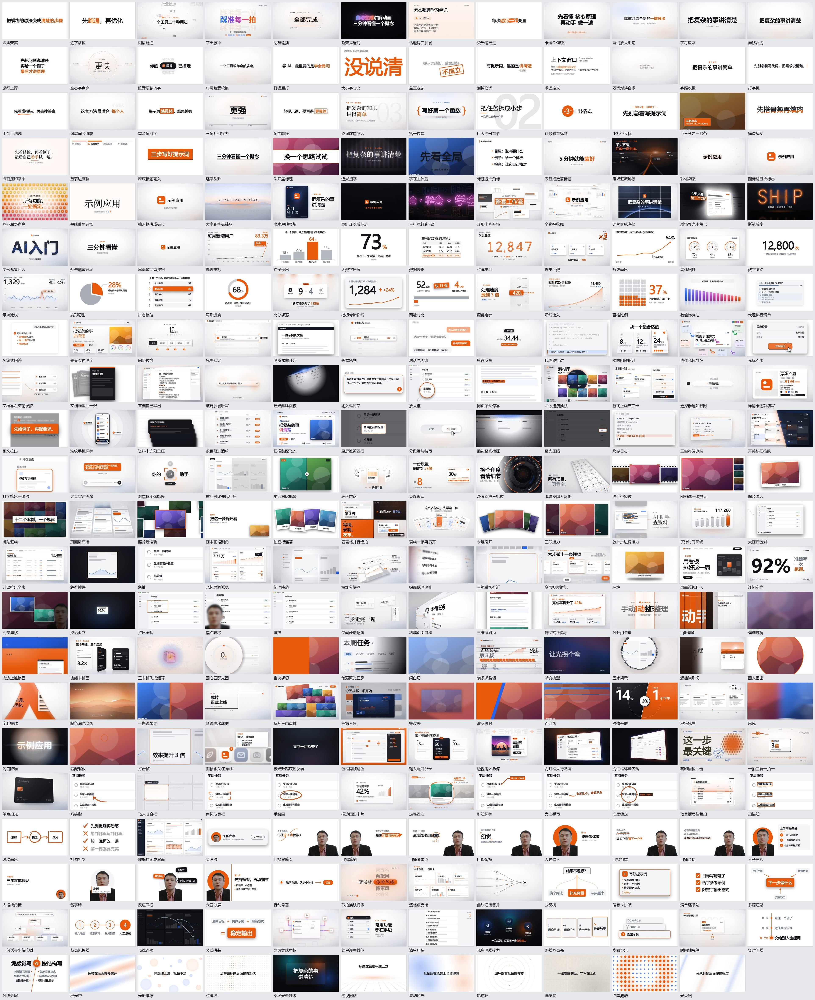

# Explainer Component Studio

做中文科普 / AI 工具讲解视频的一套 AI 助手技能，加一个通用的 HyperFrames 动效卡库。

- **三套技能**：编导与整期制作（[science-video-director](skills/science-video-director/SKILL.md)）、前期写稿与分镜（[science-video-preproduction](skills/science-video-preproduction/SKILL.md)）、H3 单镜头（[h3-science-video](skills/h3-science-video/SKILL.md)）。安装和用法见 [skills/README.md](skills/README.md)。
- **动效卡库**：263 张卡（13 个分组，新卡大多横竖屏两用），默认白底，品牌包以外所有镜头的动法都从这里来；其中有一组带真人主持人的口播卡。其中 145 张复刻自 Apache-2.0 的 [video-shotcraft](https://github.com/Vincentwei1021/video-shotcraft)，来源、许可和每张卡的改动见 `workspace-starter/motion-cards/THIRD_PARTY/`。
- **工作区骨架**：品牌包、手法库、频道复盘的空模板，和一份一步一步的 [工作区初始化指引](WORKSPACE_SETUP.md)。

## 动效卡库

[workspace-starter/motion-cards](workspace-starter/motion-cards/README.md) 分 11 组：字与强调、标题与章节、数据与图表、证据与界面、图片与多素材、镜头运动、转场、标注与手绘、人物与口播、结构与流程、幕底与氛围。

每张卡是一个动法：

- `card.md` 写命门（做错就不成立的两三件事）、动作拆解、参数手感、已知坑、哪些是动作哪些只是皮、怎么接进片子，以及它服务哪些讲解意图；
- `demo.html` 是单文件 HyperFrames 子合成，双击能预览，挂进项目就能用；
- 颜色和字体通过 `--mc-*` 变量换皮，动作不变。

「人物与口播」组里 `host-` 开头的口播卡自带一个主持人：人站一边，字和箭头、圈、角框、笔刷这些标记在另一边。示例是一张真人静态图，换成你自己抠好的透明底口播视频，人就会动；整段口播怎么接见 [卡库 README](workspace-starter/motion-cards/README.md) 的「人物卡」一节。

```bash
cd workspace-starter/motion-cards
node tools/cards.mjs serve                     # 画廊：http://localhost:3040/motion-cards/gallery/
node tools/cards.mjs site <空文件夹>           # 生成能放到网上的静态画廊（GitHub Pages 等）
node tools/cards.mjs find --intent compare --needs 数据
node tools/cards.mjs use <你的项目>/hyperframes before-after-wipe,number-roll
```

编导技能的 `shot_semantics.py` 会按旁白自动推荐卡，并把变量和卡词时间填好。加新卡的规格见 [SPEC.md](workspace-starter/motion-cards/SPEC.md)。



## 快速开始

需要 Python 3.10+、Node.js 22+、ffmpeg，以及装好 HyperFrames 官方技能的 AI 助手环境（Claude Code、Codex 等）。

```bash
git clone https://github.com/DingxinTao0417/explainer-component-studio.git
cd explainer-component-studio
python scripts/install-skills.py
python scripts/init-workspace.py --workspace <你的工作区>
python scripts/verify-skills.py
```

然后照 [工作区初始化指引](WORKSPACE_SETUP.md) 做自己的品牌包和手法库。随时运行 `python scripts/init-workspace.py --workspace <你的工作区> --check` 看还剩哪几步。

## 历史

2026-10-18 之前，这个仓库的根目录是一个 239 个组件的可编辑组件库（界面复刻、信息图、动画风场景、音效与图标），技能通过它的编导 API 选组件。它已被动效卡库取代并从仓库中移除；需要时可以在提交记录里找到最后一版（提交 `1beb61e`）。
